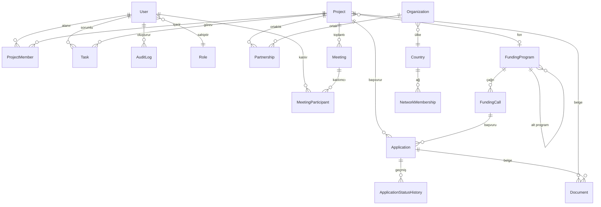

# OSMANGAZİ AR-GE 360 — Veritabanı Şeması

## ER Diyagramı

## Tablolar

### User (Kullanıcı)
| Alan | Tip | Açıklama |
|---|---|---|
| id | String (cuid) | Birincil anahtar |
| email | String (unique) | E-posta adresi |
| passwordHash | String | bcrypt ile hash'lenmiş şifre |
| name | String | Ad soyad |
| title | String? | Unvan (Endüstri Mühendisi, Yüksek Mimar, vb.) |
| department | String? | Birim |
| roleId | String | Rol FK |
| isActive | Boolean | Hesap durumu |
| isArchived | Boolean | Mantıksal silme |
| deletedAt | DateTime? | Silinme tarihi |
| createdAt | DateTime | Oluşturulma |
| updatedAt | DateTime | Güncellenme |

### Role (Rol)
| Alan | Tip | Açıklama |
|---|---|---|
| id | String (cuid) | Birincil anahtar |
| name | String (unique) | SYSTEM_ADMIN, MANAGER, STAFF, READONLY |
| label | String | Türkçe etiket |
| permissions | String | JSON: modül-işlem çiftleri |

### Project (Proje)
| Alan | Tip | Açıklama |
|---|---|---|
| id | String (cuid) | Birincil anahtar |
| name | String | Proje adı |
| code | String (unique) | OGZ-INT-FOODTRAILS |
| category | String | INTERNATIONAL, NATIONAL, CORPORATE, INTERNAL |
| description | String? | Açıklama |
| objectives | String? | Hedefler |
| fundingProgramId | String? | Fon programı FK |
| coordinatorOrg | String? | Koordinatör kurum |
| responsibleUserId | String? | Sorumlu personel FK |
| municipalUnit | String? | İlgili belediye birimi |
| startDate | DateTime? | Başlangıç |
| endDate | DateTime? | Bitiş |
| budgetAmount | Float? | Bütçe |
| currency | String | EUR, TRY, USD |
| fixedExchangeRate | Float? | Sabit sözleşme kuru |
| phase | String | IDEA, PREPARATION, SUBMITTED, APPROVED, ACTIVE, COMPLETED, ARCHIVED |
| isArchived | Boolean | Arşiv durumu |
| deletedAt | DateTime? | Mantıksal silme |
| createdAt | DateTime | Oluşturulma |
| updatedAt | DateTime | Güncellenme |

### FundingProgram (Fon Programı)
| Alan | Tip | Açıklama |
|---|---|---|
| id | String (cuid) | Birincil anahtar |
| name | String | Program adı |
| code | String? | Program kodu |
| provider | String? | Fon sağlayıcı (Avrupa Komisyonu, BEBKA, TÜBİTAK) |
| parentProgramId | String? | Üst program FK (hiyerarşi) |

### FundingCall (Fon Çağrısı)
| Alan | Tip | Açıklama |
|---|---|---|
| id | String (cuid) | Birincil anahtar |
| fundingProgramId | String | Fon programı FK |
| title | String | Çağrı başlığı |
| callCode | String? | Çağrı kodu (EU-HORIZON-CL3-2026-01-DRS-01) |
| deadline | DateTime? | Son başvuru tarihi |
| budgetInfo | String? | Bütçe bilgisi |
| eligibility | String? | Uygunluk koşulları |
| sourceUrl | String? | Resmî kaynak bağlantısı |
| notes | String? | Değerlendirme notları |

### Application (Başvuru)
| Alan | Tip | Açıklama |
|---|---|---|
| id | String (cuid) | Birincil anahtar |
| projectId | String? | Proje FK |
| fundingCallId | String? | Fon çağrısı FK |
| type | String | PROJECT_CALL, PROGRAM_APPLICATION, NETWORK_MEMBERSHIP, AWARD_COMPETITION |
| applicationDate | DateTime? | Başvuru tarihi |
| applicationNumber | String? | Başvuru numarası |
| applicantRole | String? | Başvuran rolü (Koordinatör, Partner, vb.) |
| requestedGrant | Float? | Talep edilen hibe |
| currency | String | EUR, TRY |
| status | String | DRAFT, PREPARING, REVIEWING, SUBMITTED, EVALUATING, ACCEPTED, REJECTED, WITHDRAWN |
| resultDate | DateTime? | Sonuç tarihi |
| notes | String? | Değerlendirme notları |

### ApplicationStatusHistory (Başvuru Durum Geçmişi)
| Alan | Tip | Açıklama |
|---|---|---|
| id | String (cuid) | Birincil anahtar |
| applicationId | String | Başvuru FK |
| fromStatus | String? | Önceki durum |
| toStatus | String | Yeni durum |
| changedByUserId | String? | Değiştiren kullanıcı FK |
| note | String? | Değişiklik notu |
| createdAt | DateTime | Değişiklik zamanı |

### Country (Ülke)
| Alan | Tip | Açıklama |
|---|---|---|
| id | String (cuid) | Birincil anahtar |
| name | String | Ülke adı (Türkçe) |
| nameEn | String | Ülke adı (İngilizce) |
| code | String (unique) | ISO 3166-1 alpha-2 (TR, DE, IT) |

### Organization (Kuruluş)
| Alan | Tip | Açıklama |
|---|---|---|
| id | String (cuid) | Birincil anahtar |
| name | String | Kurum adı |
| type | String | UNIVERSITY, MUNICIPALITY, NGO, PRIVATE, RESEARCH, AGENCY |
| city | String? | Şehir |
| countryId | String | Ülke FK |
| expertise | String? | Uzmanlık alanları |
| contactInfo | String? | İletişim (maskelenecek) |

### Partnership (Ortaklık)
| Alan | Tip | Açıklama |
|---|---|---|
| id | String (cuid) | Birincil anahtar |
| projectId | String | Proje FK |
| organizationId | String | Kuruluş FK |
| role | String | COORDINATOR, PARTNER, ASSOCIATE |
| status | String | ACTIVE, COMPLETED, SUSPENDED |

### Task (Görev)
| Alan | Tip | Açıklama |
|---|---|---|
| id | String (cuid) | Birincil anahtar |
| title | String | Görev başlığı |
| description | String? | Açıklama |
| projectId | String? | Proje FK |
| assignedUserId | String? | Atanan personel FK |
| priority | String | LOW, MEDIUM, HIGH, URGENT |
| status | String | TODO, IN_PROGRESS, REVIEW, DONE, CANCELLED |
| dueDate | DateTime? | Termin tarihi |

### Meeting (Toplantı)
| Alan | Tip | Açıklama |
|---|---|---|
| id | String (cuid) | Birincil anahtar |
| title | String | Toplantı başlığı |
| type | String | ONLINE, IN_PERSON, HYBRID |
| date | DateTime | Toplantı tarihi |
| projectId | String? | İlgili proje FK |
| agenda | String? | Gündem |
| minutes | String? | Tutanak |
| decisions | String? | Kararlar |

### Document (Belge)
| Alan | Tip | Açıklama |
|---|---|---|
| id | String (cuid) | Birincil anahtar |
| name | String | Dosya adı |
| type | String | CONTRACT, REPORT, PROPOSAL, CORRESPONDENCE, OTHER |
| filePath | String | Dosya yolu |
| version | String | v1.0, v1.1 |
| projectId | String? | Proje FK |
| applicationId | String? | Başvuru FK |
| uploadedByUserId | String | Yükleyen FK |

### AuditLog (Denetim Kaydı)
| Alan | Tip | Açıklama |
|---|---|---|
| id | String (cuid) | Birincil anahtar |
| userId | String | Kullanıcı FK |
| action | String | CREATE, UPDATE, DELETE, LOGIN, LOGIN_FAILED, PERMISSION_DENIED |
| entity | String | Varlık adı (Project, Application, vb.) |
| entityId | String? | Varlık ID |
| oldValue | String? | Eski değer (JSON) |
| newValue | String? | Yeni değer (JSON) |
| ipAddress | String? | IP adresi |
| createdAt | DateTime | Zaman damgası |

## İndeksler
- `User.email` — Unique
- `Project.code` — Unique
- `Country.code` — Unique
- `Project.category` — Index (filtreleme)
- `Application.status` — Index (filtreleme)
- `Task.assignedUserId` + `Task.status` — Composite Index
- `AuditLog.userId` + `AuditLog.createdAt` — Composite Index

## Silme Davranışları
- **Fiziksel silme yapılmaz.** Tüm ana tablolarda `isArchived` ve `deletedAt` alanları bulunur.
- Cascade: `ApplicationStatusHistory` → Application silindiğinde geçmiş de silinir.
- SetNull: `Project.responsibleUserId` → Kullanıcı arşivlendiğinde null olur.
